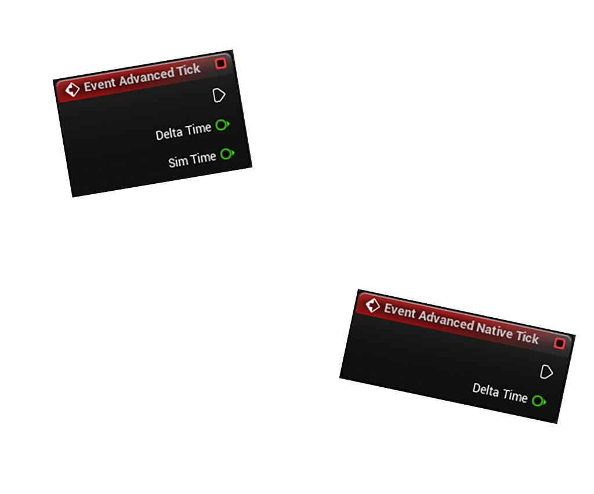

Advanced Physics Tick
=====================

<div align="center">

</div>

Advanced Physics Tick is a specialized plugin for Unreal Engine 5, built to leverage of the Chaos physics system in blueprints or code. It is designed specifically for advanced vehicle simulation, offering precise and flexible motion control. Unlike general-purpose physics plugins, Advanced Physics Tick focuses exclusively on delivering robust and high-fidelity vehicle dynamics, making it ideal for projects requiring realistic vehicle behavior, such as racing games or automotive simulations.

Key features include thread-safe physics operations, detailed state queries for real-time vehicle data, replication and customizable tick functions for tailored simulation logic.

Important notice for version 3.0 and up.
=====================

Starting with version 3.0, the plugin modules have been completely rewritten from *ADVANCEDPLUGIN_API* to *ADVANCEDPHYSICS_API*, to unify names and improve consistency. This change may cause compatibility issues when upgrading from older versions (2.X - 1.X). Be sure to check and update your project configurations and code, especially Blueprints in editor, as there may be issues with reparenting after compiling the plugin to match the new module structure.

**Blueprint Reparenting Instructions:** To safely transition Blueprints using **AAdvancedPawn** to version 3.0, follow these steps to avoid errors:

1. In the Unreal Editor, reparent all Blueprint classes using **AAdvancedPawn** to the base **APawn** class.
2. Save and close your Unreal Engine project.
3. Replace the old plugin version with the new version 3.0 and up by cloning or copying the updated plugin folder into your **project Plugins directory** or **engine Plugins directory**.
4. Compile the new plugin version and open your project.
5. Reparent BP class back to **AAdvancedPawn_X***.
6. Clean up all deprecated nodes from old AdvancedPhysicsTick plugin. Replace to new nodes.

*There are classes to choose from: **AAdvancedPawn_Static** and **AAdvancedPawn_Skeletal**

- **AAdvancedPawn_Static** - with VehicleMesh (UStaticMeshComponent)
- **AAdvancedPawn_Skeletal** - with VehicleMesh (USkeletalMeshComponent)

_VehicleMesh acts as a physics component, providing a streamlined and optimized approach to handling vehicle physics, ensuring stability and performance even in complex scenarios. Automatically attaches and applies physics forces, such as AddForce, AddForceAtPosition, and binds VehicleState, for GetVehicleWorldTransform(), GetVehicleLocalAcceleration() and more..._

Repository Branches
=====================

This repository uses the following several branches and tags:

* main: Main branch for developing, maybe with errors and inconsistencies.
* old-release-X.X: Legacy branches for older releases (e.g., old-release-1.0, old-release-2.0). These are considered deprecated, and users are strongly encouraged to transition to the main branch for the most up-to-date features. **Will be removed in the future**

Tags:

* release tags: Latest releases with latest updates are recommended for use.

Setup
=====================

- Clone or download the repository from GitHub:
```
git clone https://github.com/AlexanderZhmurkin/AdvancedPhysicsTick.git
```
or

- Fork and download the repository from GitHub.

then

- Place the plugin folder in the plugins directory of your Unreal Engine 5 project.
- Run Unreal Engine 5 project.

Documentation
=====================

### 1. AddForce, AddForceAtLocation and etc...

-   Use these functions to interact with VehicleMesh in **UAdvancedMovementComponent**
	> THREADSAFE! CALL THIS FUNCTIONS ONLY PhysicThread!

```
UFUNCTION(BlueprintCallable, Category = "AdvancedPawn|Physics")
void AddForce(const FVector& Force, bool bAllowSubstepping = true, bool bAccelChange = false);

UFUNCTION(BlueprintCallable, Category = "AdvancedPawn|Physics")
void AddForceAtLocation(const FVector& Force, const FVector& Position, bool bAllowSubstepping = true, bool bIsLocalForce = false);

UFUNCTION(BlueprintCallable, Category = "AdvancedPawn|Physics")
void AddImpulse(const FVector& Impulse, bool bVelChange);

UFUNCTION(BlueprintCallable, Category = "AdvancedPawn|Physics")
void AddTorqueInRadians(const FVector& Torque, bool bAllowSubstepping = true, bool bAccelChange = false);
```

---

-   Use VehicleState for get transform and velocity from VehicleMesh

```
UFUNCTION(BlueprintCallable, Category = "AdvancedPawn|State")
FTransform GetVehicleWorldTransform() const { return VehicleState.VehicleWorldTransform; }

UFUNCTION(BlueprintCallable, Category = "AdvancedPawn|State")
FVector GetVehicleWorldVelocity() const { return VehicleState.VehicleWorldVelocity; }

UFUNCTION(BlueprintCallable, Category = "AdvancedPawn|State")
FVector GetVehicleWorldVelocityNormal() const { return VehicleState.VehicleWorldVelocityNormal; }

UFUNCTION(BlueprintCallable, Category = "AdvancedPawn|State")
float GetVehicleWorldVelocitySize() const { return GetVehicleWorldVelocity().Size(); }

UFUNCTION(BlueprintCallable, Category = "AdvancedPawn|State")
float GetVehicleForwardSpeed() const { return FVector::DotProduct(GetVehicleWorldVelocity(), VehicleState.VehicleXVector); }

UFUNCTION(BlueprintCallable, Category = "AdvancedPawn|State")
float GetVehicleRightSpeed() const { return FVector::DotProduct(GetVehicleWorldVelocity(), VehicleState.VehicleYVector); }
```

---
Blueprint graph implementation

<div align="left">
    
</div>

### 2. GetLinearVelocityAtPoint.

```
UFUNCTION(BlueprintCallable, Category = "AdvancedPawn|Physics")
FVector GetLinearVelocityAtPoint(const UPrimitiveComponent* TargetComponent, const FVector& InPoint);
```
#### Params:
-   `InComponent`: Component to which the force will be applied with bSimulatePhysics = true.
-   `InPoint`: Point velocity.

	> THREADSAFE! CALL THIS FUNCTION ONLY AdvancedTick in BP or PhysicsTick in C++!
---

### 3. AdvancedTick and AdvancedNativeTick.

You can override TickVehicle and PhysicsTick in your class for advanced physics logic:

**TickVehicle (AdvancedNativeTick)**
```
virtual void TickVehicle(float DeltaTime) override;
```
Parameters:
-   `DeltaTime`: GameThread, userful for control wake/sleeping vehicle mesh, visual effects, sounds and animations.

    > AdvancedNativeTick can sometimes be called twice and also has a minimum DeltaTime of 1/20.

---

**PhysicsTick (AdvancedTick)**
```
virtual void PhysicsTick(UWorld* InWorld, float DeltaTime, float SimTime, Chaos::FRigidBodyHandle_Internal* InHandle) override;
```
Parameters:
-   `DeltaTime`: PhysicThread, userful for simulation and apply forces.
-   `SimTime`: Current simulation time.

---
Blueprint graph implementation
<div align="left">
    
</div>

### 3. Stat and Debugging
Unfortunately, you can't currently use DrawDebugHelpers in a physics thread, otherwise it will crash the UnrealEngine or cause HandledEnsure type errors.
For PhysicThread use in C++
Chaos::FDebugDrawQueue::GetInstance().DrawDebug.....
or for Blueprints use CVars AdvancedPawn

Stat command for drawing applied forces as lines and arrows.
```
p.RacingVehicle.AdvPawn.DrawAllForces 1
```
Automatically this CVar activates p.Chaos.Debug Draw.Enabled

Stat ```DECLARE_CYCLE_STAT``` Allows you to see in PIE the number of calls and the time taken in ms. Userful for debugging and profiling.

1. For AdvancedPawn calls AdvancedTick and AdvancedNativeTick
```
stat AdvancedPawn
```
<div align="center">
    
</div>

2. For AdvancedCallback calls ProcessInputs_Internal and OnPreSimulate_Internal
```
stat RacingManager
```
<div align="center">
    
</div>

Throbleshooting
=====================
There are no problems yet...

Where is it used?
=====================

1. NWheelVehicle project. Author: Ivan Novozhilov. Links: [Boosty](https://boosty.to/ivan_novozhilov), [YouTube](https://www.youtube.com/@%D0%98%D0%B2%D0%B0%D0%BD%D0%9D%D0%BE%D0%B2%D0%BE%D0%B6%D0%B8%D0%BB%D0%BE%D0%B2-%D1%8D9%D0%B7)
<div align="center">
    
</div>

Licensing
=====================
You can use this plugin anywhere and for free, except for those that do not comply with the ***[Unreal Engine](https://www.unrealengine.com/en-US/eula/unreal)*** brand.